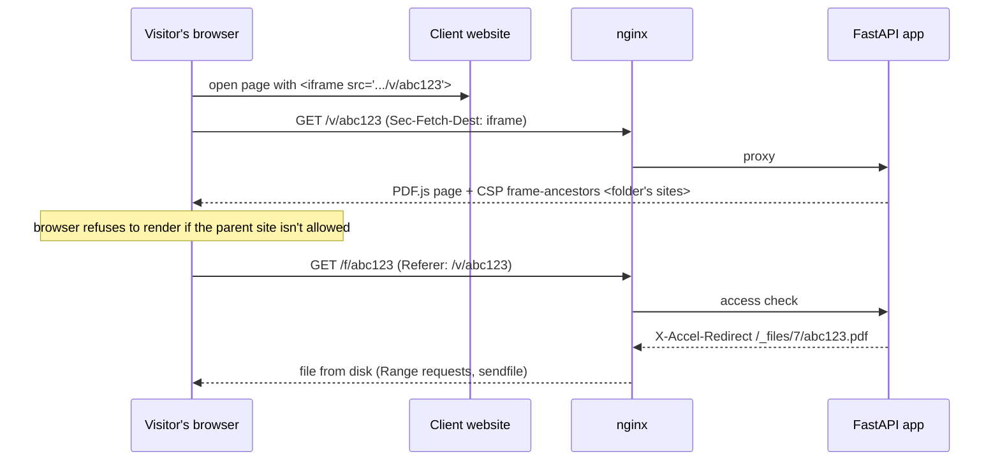
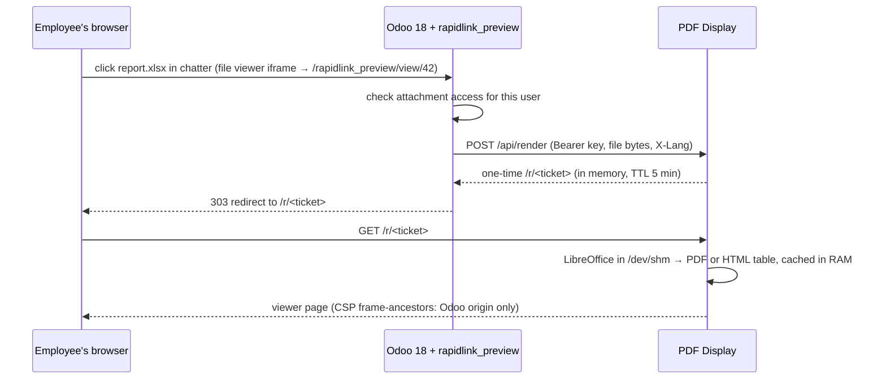

# PDF Display

Self-hosted document embedding and preview service: a drop-in replacement for embedding PDFs through Scribd or Google Drive, plus on-the-fly Word / Excel / PowerPoint preview for Odoo 18.

    

Two jobs, one small service:

1. **Hosted PDFs for client websites.** Upload a PDF in the admin panel and get a permanent link and a ready `<iframe>` snippet. Each client gets a folder with its own storage quota and a whitelist of websites that may embed its documents. Every other website gets a blank frame.
2. **Office preview for Odoo, with nothing stored.** Odoo Community can't preview `.docx`/`.xlsx`/`.pptx`. A small Odoo module sends the file to this service, which converts it **in RAM** (LibreOffice in tmpfs) and returns a one-time link that expires after 5 minutes. Documents are shown as PDF; spreadsheets as real tables with sheet tabs.

In production at an ISP: client sites embed price lists and contracts, and staff preview office attachments right in the Odoo chatter.

---

## Table of contents

- [Features](#features)
- [Architecture](#architecture)
- [Security design](#security-design)
- [Tech stack](#tech-stack)
- [Project structure](#project-structure)
- [Installation](#installation)
- [Odoo integration](#odoo-integration)
- [REST API](#rest-api)
- [Testing](#testing)
- [License](#license)

## Features

**Embedding for client websites**
- Folders per client: allowed websites (the `www.` variant and http/https are added automatically, IDN domains supported) and a storage quota.
- Permanent links: replacing a file keeps its URL, so pages on client websites don't need updating.
- PDF.js 6 viewer with download and print. Mobile browsers render the document in the iframe instead of offering a download.
- Opening a link directly (outside an iframe) is blocked by default and can be enabled per folder.

**Office preview for Odoo**
- Word, RTF, OpenDocument, PowerPoint → PDF in the same viewer.
- Excel / ODS / CSV → HTML tables with sheet tabs, cell colours, merged cells and embedded images.
- Conversion runs in RAM only (`/dev/shm`). Results are cached in memory for 5 minutes, then forgotten.
- Messages follow the Odoo user's language (English, Romanian, Russian).

**Admin panel**
- Vanilla JS single-page app, no build step: drag-and-drop multi-upload with progress, copy iframe code, preview, replace, rename, delete.
- Login and password management: the password must have at least 10 characters, a strength meter, and a generator built on `crypto.getRandomValues`.
- Light and dark theme, remembered per browser.

## Architecture

### Embedding a hosted PDF



The app never streams file bytes itself: it checks access, and nginx serves the file through an internal location.

### Office preview from Odoo



Odoo pushes the file instead of the service pulling it, so Odoo never needs to be reachable from the render server, and access control stays inside Odoo.

## Security design

| Threat | Mitigation |
|---|---|
| Someone embeds a client's documents on their own site | `Content-Security-Policy: frame-ancestors` built from the folder's allowed websites |
| Opening or hotlinking the viewer URL directly | `Sec-Fetch-Dest: document` → 403 (configurable per folder) |
| Downloading the raw PDF bypassing the viewer | `/f/<id>` requires `Sec-Fetch-Site: same-origin` and a `Referer` of its own `/v/<id>` page. `Referrer-Policy: same-origin` ensures the browser sends it |
| Using an allowed page to show another folder's file (`?file=`) | the viewer page rejects `file` query parameters, and the file endpoint checks that the `Referer` points at the same id |
| Script injection through spreadsheet content | strict CSP on rendered tables (`default-src 'none'`, own scripts only, `img-src data:`), event attributes and `<script>` stripped |
| Leaking Odoo documents | access is checked in Odoo before upload; tickets are random 192-bit tokens kept in memory for 5 minutes; nothing is written to disk. Filenames travel in a header, not the URL, so they don't end up in access logs |
| Password guessing | scrypt hashes, per-IP login throttling, constant-time comparison with a dummy hash for unknown users, minimum password length 10 |
| Session theft / CSRF | random session tokens stored as SHA-256 hashes, `HttpOnly` + `Secure` + `SameSite=Lax` cookies; changing the password logs out all other sessions |
| Admin panel clickjacking / XSS | `frame-ancestors 'none'`, `default-src 'self'`; the UI builds the DOM with `textContent` only |
| Service compromise impact | systemd sandbox (`ProtectSystem=strict`, `NoNewPrivileges`, `PrivateTmp`); database not readable by nginx |

## Tech stack

- **Backend:** Python 3.13, FastAPI, Uvicorn, SQLite (WAL)
- **Viewer:** Mozilla PDF.js 6 (legacy build for older mobile browsers)
- **Conversion:** LibreOffice 25 headless, one process at a time on a 1-vCPU VM, with a timeout and process-group kill
- **Web server:** nginx (TLS, `X-Accel-Redirect`, static files)
- **Frontend:** vanilla HTML/CSS/JS, no build step
- **Odoo:** 18 Community module (OWL patch of the file viewer, HTTP controller, translations)

## Project structure

```
pdf-display/
├── app/
│   ├── main.py        # FastAPI app: auth, folders, files, viewer and render endpoints
│   ├── render.py      # in-memory tickets, LibreOffice conversion, spreadsheet → HTML
│   ├── core.py        # settings, SQLite schema, scrypt password hashing
│   ├── texts.py       # user-facing messages in en / ro / ru
│   └── cli.py         # pdfdisplay-admin: create users, reset passwords, rename
├── admin/             # admin single-page app (index.html, app.js, app.css, theme.js)
├── static/            # PDF.js setup, spreadsheet viewer, favicons
├── odoo_addons/
│   └── rapidlink_preview/   # Odoo 18 module: Office preview in the attachment viewer
├── deploy/            # nginx site, systemd unit, environment example
├── scripts/make_icons.py    # renders favicon.ico / apple-touch-icon.png without dependencies
└── tests/             # pytest: access control, embedding rules, render tickets, i18n
```

## Installation

Tested on Debian 13. Everything comes from distribution packages, so no virtualenv is needed.

```bash
# 1. Packages
sudo apt install nginx certbot python3-fastapi python3-uvicorn python3-multipart python3-pydantic \
  libreoffice-core-nogui libreoffice-writer-nogui libreoffice-calc-nogui libreoffice-impress-nogui \
  fonts-dejavu fonts-liberation2 fonts-crosextra-carlito fonts-crosextra-caladea fonts-noto-core unzip curl

# 2. Code and PDF.js
sudo mkdir -p /opt/pdfdisplay
sudo cp -r app admin static /opt/pdfdisplay/
curl -sSLo /tmp/pdfjs.zip https://github.com/mozilla/pdf.js/releases/download/v6.4.299/pdfjs-6.4.299-legacy-dist.zip
sudo unzip -q /tmp/pdfjs.zip -d /opt/pdfdisplay/pdfjs

# 3. Service user and data directories (nginx reads files via group www-data)
sudo useradd --system --home /srv/pdfdisplay --shell /usr/sbin/nologin pdfdisplay
sudo install -d -o pdfdisplay -g www-data -m 0750 /srv/pdfdisplay
sudo install -d -o pdfdisplay -g www-data -m 2750 /srv/pdfdisplay/files
sudo install -d -o pdfdisplay -g pdfdisplay -m 0700 /srv/pdfdisplay/db /srv/pdfdisplay/tmp

# 4. Configuration
sudo install -d -m 0755 /etc/pdfdisplay
sudo install -m 0600 deploy/pdfdisplay.env.example /etc/pdfdisplay/pdfdisplay.env   # then edit it
sudo cp deploy/pdfdisplay.service /etc/systemd/system/
sudo cp deploy/nginx.conf.example /etc/nginx/sites-available/pdf.example.com          # set your domain
sudo ln -s /etc/nginx/sites-available/pdf.example.com /etc/nginx/sites-enabled/
sudo certbot certonly --webroot -w /var/www/html -d pdf.example.com

# 5. Admin CLI and the first user
printf '#!/bin/sh\nexec sudo -u pdfdisplay PD_DATA_DIR=/srv/pdfdisplay /usr/bin/python3 /opt/pdfdisplay/app/cli.py "$@"\n' \
  | sudo tee /usr/local/sbin/pdfdisplay-admin >/dev/null && sudo chmod 755 /usr/local/sbin/pdfdisplay-admin
sudo systemctl daemon-reload && sudo systemctl enable --now pdfdisplay && sudo systemctl reload nginx
sudo pdfdisplay-admin set-password admin
```

Open `https://pdf.example.com/admin/`, create a folder for a client website, upload a PDF and paste the iframe code into that site.

### Configuration

| Variable | Default | Meaning |
|---|---|---|
| `PD_PUBLIC_URL` | `http://localhost:8000` | public base URL used in links and iframe code |
| `PD_DATA_DIR` | `/srv/pdfdisplay` | database and stored files |
| `PD_MAX_FILE_MB` | `2048` | maximum upload size for hosted PDFs |
| `PD_RENDER_TOKEN` | — | shared key for `POST /api/render`. The Odoo preview is disabled without it |
| `PD_ODOO_ORIGINS` | — | space-separated origins allowed to frame Odoo previews |
| `PD_PDFJS_DIR` | `/opt/pdfdisplay/pdfjs` | unpacked PDF.js distribution |

## Odoo integration

1. Copy `odoo_addons/rapidlink_preview` into your addons path and install the module.
2. Set the system parameters (Settings → Technical → System Parameters):
   - `rapidlink_preview.url`: e.g. `https://pdf.example.com`
   - `rapidlink_preview.secret`: the same value as `PD_RENDER_TOKEN`
3. Add the Odoo origin to `PD_ODOO_ORIGINS` and restart the service.

The module patches the web client's `FileModel`/`Attachment` so office files count as viewable, and adds an iframe to the standard `web.FileViewer`. Server-side, `/rapidlink_preview/view/<id>` runs Odoo's own attachment access checks before anything leaves Odoo.

## REST API

Interactive OpenAPI docs are served at `/api/docs`. Log in through `POST /api/login` there to try the endpoints. Main endpoints:

| Method | Path | Purpose |
|---|---|---|
| `POST` | `/api/login`, `/api/logout` | session cookie |
| `POST` | `/api/me/password`, `/api/me/username` | change own password / login (requires the current password) |
| `GET POST PATCH DELETE` | `/api/folders[/{id}]` | client folders: name, allowed websites, quota |
| `GET` | `/api/files?folder_id=&q=` | list and search files, with `view_url` and `embed_html` |
| `POST` | `/api/folders/{id}/files` | upload a PDF (multipart) |
| `PUT PATCH DELETE` | `/api/files/{id}` | replace content (same link) / rename / delete |
| `POST` | `/api/render` | Odoo → one-time preview link (Bearer key, raw body, `X-Filename`, `X-Lang`) |

Public, non-API routes: `/v/{id}` (embeddable viewer), `/f/{id}` (file, viewer-only), `/r/{ticket}` (Odoo preview).

## Testing

```bash
python -m venv .venv && . .venv/bin/activate
pip install -r requirements-dev.txt
pytest
```

The tests run against a temporary data directory. Neither nginx nor LibreOffice is needed. They cover login and password rules, the embedding rules (CSP, direct-open block, referer-bound file access, `?file=` rejection), quotas and upload validation, render tickets, spreadsheet sanitising and localized messages.

## License

MIT, see [LICENSE](LICENSE). The Odoo module is LGPL-3, as is customary for Odoo addons.
